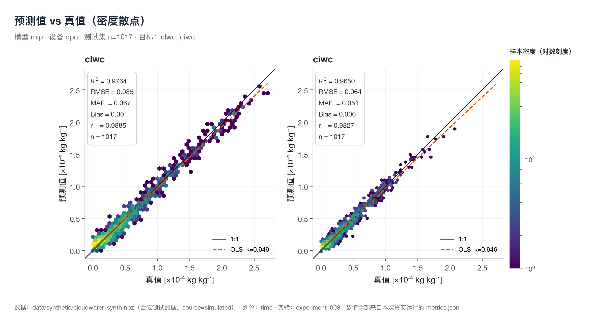
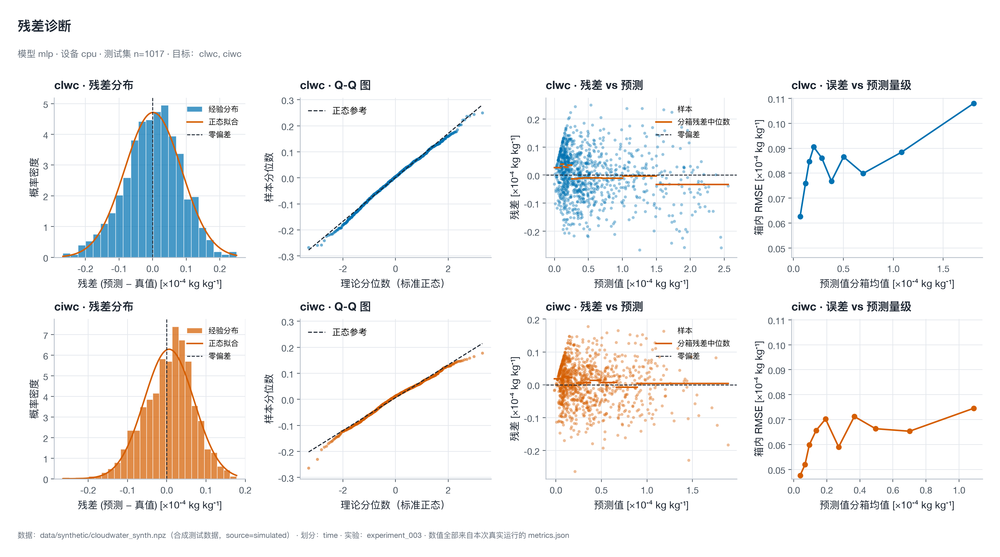
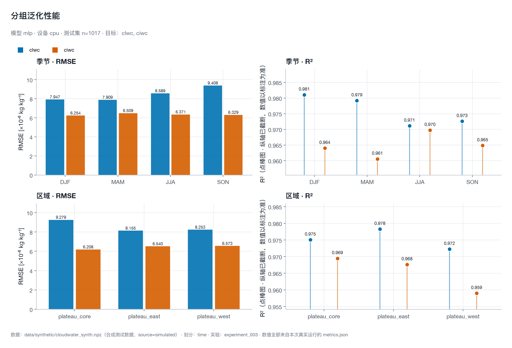
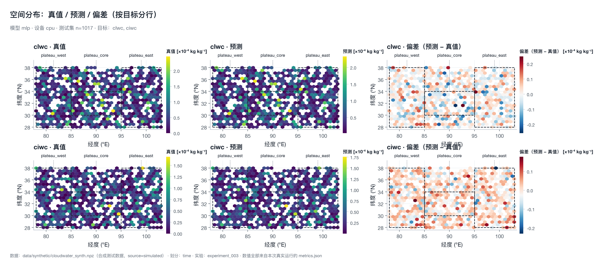
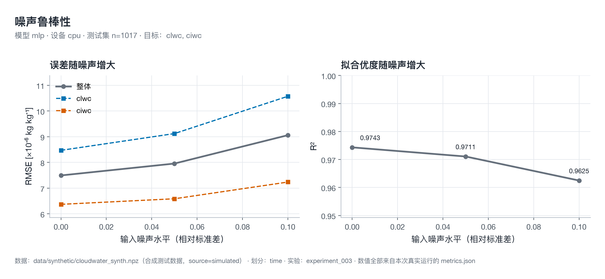

# CloudWater ML Platform v2.0

**云水资源科研机器学习平台** — 从 TB 级 ERA5 NetCDF 到 GPU 训练、物理约束、可复现实验管理的完整链路。


面向大气科学 / 云水资源综合评价：**CLWC / CIWC 反演**、**CWP 预测**、**时空场重建**、
**仿真-真实数据融合训练**，以及可复现的实验管理与物理一致性验证。

```text
数据接入 → Dataset → DataLoader → Model → Loss(+物理约束) → Backprop
   → Validation → Checkpoint → Metrics → Uncertainty → Visualization → Experiment Record
```

---

## 本轮实验结果（experiment_003 · MLP 基线）

> 完整实验报告：**[`docs/experiment_report.md`](docs/experiment_report.md)**

| 项 | 值 |
|---|---|
| 实验 | `exp_20261107_230836_adb42f` · MLP `[128,64]` · seed 42 · CPU / fp32 · 耗时 **31.77 s** |
| 数据 | **合成**（`source=simulated`，5000 样本，2015–2019）——**不是真实 ERA5** |
| 划分 | **按时间**：train ≤2017（2945）/ val 2018（1038）/ test 2019（1017） |
| 测试集 | MAE **5.9232×10⁻⁶** · RMSE **7.4938×10⁻⁶** kg kg⁻¹ · R² **0.97433** · Bias **+3.75×10⁻⁷** |
| 逐目标 | `clwc` R² 0.97637 / RMSE 8.4695×10⁻⁶ · `ciwc` R² 0.96501 / RMSE 6.3703×10⁻⁶ |
| 泛化 | 季节 R² 0.9713–0.9777 · 区域 R² 0.9697–0.9756 · 10 % 噪声下 R² 0.9625 |
| 物理一致性 | **FAIL** —— 3 个近零样本出现负云水含量（详见报告 §6） |
| 可核验性 | 图件由**带断言的出图管线**产出：复现预测 → 与 `metrics.json` 逐项比对（<10⁻⁶）→ 通过才出图 |



*密度散点取代逐点散点：1017 个样本聚合成可读的二维密度场，1:1 线 + OLS 拟合 + 统计框同图。*

| 残差诊断 | 分组泛化 |
|---|---|
|  |  |

| 空间分布 | 噪声鲁棒性 |
|---|---|
|  |  |

> ⚠️ **这组数字的边界**：合成数据上的 R²=0.97 只证明**模型与数据生成器一致**，
> **不证明对真实大气场有效**；真实 ERA5 上的科研结论仍为 **NOT_RUN**。

---

## 为什么需要它

云水含量反演是典型的**小样本 + 强物理约束 + 时空自相关**的科研问题。常见的坑：

| 坑 | 本平台的做法 |
|---|---|
| 随机划分让相邻网格/相邻时刻泄漏到测试集 | 时间/年份/区域/来源划分 + **场景分组**防同源泄漏 |
| 归一化用了全集统计量 → 隐性泄漏 | 统计量**只在训练集拟合**，并记录拟合证据（可校验） |
| 把 `kg kg⁻¹` 当 `kg m⁻³` 积分 → CWP 高估 1.2 倍 | 单位感知的柱积分公式，**口径不符直接报错** |
| 预测出负的云水含量 | 可选 softplus 输出头做**非负硬约束**（训练/推理一致） |
| 把预测误差当置信区间 | 分割共形区间（有覆盖率保证）+ CRPS，**无保证的方法显式标注** |
| 实验无法复现 | 记录 git commit、数据指纹、随机流、依赖版本、运行时计划 |
| 续训后曲线断裂、学习率重启 | 检查点保存 scheduler/scaler/**RNG**/历史/早停状态 |
| 图出来是一团糊点、坐标轴全是 0.0000x | **出版级绘图管线**：密度散点 + 统一设计系统 + 量级换算 + 出图前核对指标 |

---

## 特性

| 能力 | 说明 |
|---|---|
| **GPU 训练引擎** | CUDA / MPS / CPU 自动探测；AMP（fp32/fp16/bf16 + GradScaler）；梯度累积（含尾部 flush）；梯度裁剪；channels_last；torch.compile；梯度检查点；峰值显存记录；OOM 捕获与建议 |
| **大规模数据** | NetCDF 按时间/空间/气压层/变量**按需读取**；分块与**流式训练**；分级缓存（版本化、可失效、可清理、**永不写 data/raw**）；不默认整载入内存 |
| **质量与溯源** | NaN/Inf、异常值、经纬度、时间连续性、气压层、单位、缺测分布；每样本 `source/source_origin/dataset/scene_id`；数据文件指纹 |
| **模型生态** | MLP · RandomForest · LightGBM · XGBoost · CNN · U-Net · ConvLSTM · MultiTask（8/8 已实现并注册） |
| **物理约束** | 可插拔接口、单位感知、硬/软分离、逐分量记录；非负约束可用；CWP 积分/水量守恒/廓线结构/水循环为**预留**（构造即抛，不伪装） |
| **不确定性** | 分割共形区间（覆盖率保证）+ CRPS + 覆盖率/宽度/CWC |
| **实验管理** | 生命周期状态机（CREATED→…→COMPLETED/FAILED/INTERRUPTED）、唯一实验 ID、**拒绝覆盖**、断点续训、结果对比 |
| **出版级可视化** | 密度散点 / 残差四联诊断 / 分组泛化 / 空间三联 / 噪声鲁棒性 / 量级-误差；统一色盲友好配色与量级刻度；**出图前自动核对指标**，对不上就中止 |
| **性能基准** | 吞吐、数据/传输/计算三段耗时、峰值显存；按**实测硬件**给配置建议（不写死型号） |

---

## 快速开始

```bash
git clone <your-repo-url> && cd DBAS-ML
python -m venv .venv && source .venv/bin/activate
pip install -e ".[dev]"

cloudwater doctor                                     # 环境体检
cloudwater train --config configs/experiments/mlp_baseline.yaml
cloudwater report --experiment experiment_001
```

仓库自带**合成**测试数据（`source=simulated`，仅用于跑通工程链路，**不得当作观测**）。

### GPU 环境

```bash
# RTX 50 系（Blackwell, sm_120）需要 cu128 构建
pip install torch --index-url https://download.pytorch.org/whl/cu128
cloudwater gpu info
python scripts/gpu_acceptance.py --json outputs/gpu_acceptance.json   # 一键验收
```

### 重绘实验图件（带指标核对）

```bash
# 从任意已完成实验目录重绘出版级图件；脚本会先用结果包里的模型
# 精确复现测试集预测并与 metrics.json 比对，对不上就中止出图
python scripts/make_experiment_figures.py --experiment outputs/experiment_003
```

---

## 常用命令

```bash
cloudwater doctor                     # 依赖/设备/目录/模型体检
cloudwater gpu info                   # GPU/CUDA/MPS 详情
cloudwater gpu benchmark              # 吞吐 + 瓶颈 + 峰值显存 + 配置建议
cloudwater models list                # 模型注册表（状态随代码自动更新）
cloudwater inspect  -c configs/data.yaml        # 数据结构（只读）
cloudwater data validate -c configs/data.yaml   # 数据质量报告
cloudwater cache info | cache clear   # 缓存运维（可清理/可重建）
cloudwater train    -c configs/experiments/mlp_baseline.yaml
cloudwater resume   -e experiment_001           # 断点续训（新建实验，不覆盖）
cloudwater evaluate -e experiment_001
cloudwater compare  -e exp1 exp2
cloudwater report   -e experiment_001 | report   # 单实验 / 全部对比
```

---

## 数学规格

所有模型、损失、指标、约束、不确定性方法的公式与**代码位置对照**见
**[`docs/formulation.md`](docs/formulation.md)**。核心几条：

- **CWP 柱积分**（口径 A，CLWC 为 kg kg⁻¹）：

  $$\mathrm{CWP}=\int_{z_b}^{z_t}\rho_{\text{air}}(z)\,\mathrm{CLWC}(z)\,\mathrm{d}z\approx\sum_k\rho_k\,\mathrm{CLWC}_k\,\Delta z_k$$

  若 CLWC 已是 kg m⁻³ 则**不能再乘 $\rho$**（平台会报错拦截）。

- **组合损失**：$\mathcal{L}_{\text{total}}=\mathcal{L}_{\text{data}}+\sum_i\lambda_i\mathcal{L}_{\text{phys},i}$，物理项作用在**物理单位**上。

- **梯度累积尾部修正**：当 $N_b\bmod A=P\ne0$ 时，尾部梯度按 $A/P$ 修正后再更新，避免样本被静默丢弃。

- **共形区间**：$q=Q_{1-\alpha}(|y-\hat y|_{\text{calib}})$，$P(Y\in[\hat y-q,\hat y+q])\ge 1-\alpha-\frac{1}{|\mathcal{C}|+1}$。

---

## 项目结构

```
src/cloudwater_ml/
├── hardware/     设备探测 · 精度策略(AMP) · 显存监控 · 性能剖析
├── training/     Trainer(AMP/累积/裁剪/检查点) · RuntimePlan · 损失 · 调度
├── data/         适配器(netcdf/array) · 流式 · 分级缓存 · 质量 · 划分 · 真仿融合
├── models/       base(契约+注册表) · mlp/rf/lgbm/xgb · cnn/unet/convlstm/multitask
├── physics/      约束接口 · 单位 · 柱积分 · 校验器(四态) · 兼容桥
├── evaluation/   指标(MAE/MSE/RMSE/R²/NSE/Pearson) · 泛化 · 鲁棒性 · 不确定性
├── experiments/  生命周期状态机 · 溯源(git/数据指纹) · 编排 · 产物
├── visualization/ style(设计系统) · publication(出版级图) · 速览图
├── benchmark/    吞吐/瓶颈/显存 + 配置建议
└── utils/        配置校验 · 异常体系 · 结构化日志 · 可复现

configs/   实验配置（experiments/*.yaml 可直接运行）
docs/      16 篇文档（架构/审计/公式/GPU/数据/模型/物理/实验/基准/复现/部署/实验报告…）
docs/figures/experiment_003/   版本化的出版级图件（报告与 README 引用）
scripts/   make_experiment_figures.py · gpu_acceptance.py · cloudwater 启动器 · 数据检查
tests/     303 passed / 6 skipped（CUDA 与未装依赖自动跳过）
```

---

## 复现性

每次实验落盘：`experiment_id`、**git commit（含 dirty 标记）**、**数据文件指纹**
（size/mtime/sha256 片段）、展开配置快照、随机种子、依赖版本、GPU/CUDA/PyTorch 版本、
**运行时计划**、耗时、**峰值显存**、全部指标与损失分量。

```bash
cloudwater report --experiment experiment_001     # 看溯源与指标
```

> GPU 非确定性算子（原子加、部分卷积反向）**不保证位级一致**；平台承诺「同种子 + 同数据 +
> 同配置 + 同环境 ⇒ 统计一致」，详见 [`docs/reproducibility.md`](docs/reproducibility.md)。
>
> 本轮 experiment_003 在 **Windows / torch 2.9.1** 上训练，在 **macOS / torch 2.15.0** 上
> 用结果包复现了测试集预测，MAE/RMSE/R²/Bias 一致到 **10⁻⁶ 以内**——跨 PyTorch 版本可复现。

---

## 当前状态与边界（诚实声明）

| 项 | 状态 |
|---|---|
| 单元/集成/端到端测试 | ✅ 303 passed, 6 skipped |
| Lint（ruff） | ✅ 0 error |
| 8 个模型可训练 | ✅ 前向/梯度/存取/最小训练全部通过 |
| 端到端流式训练（NetCDF→训练） | ✅ 真实 NetCDF 测试通过 |
| 物理非负硬约束 | ✅ `negative_values` 检查 FAIL→PASS（需把 `output_activation` 设为 `softplus`） |
| 出版级图件 + 出图前指标核对 | ✅ 7 类图，核对不过即中止 |
| **experiment_003 端到端实跑** | ✅ CPU / 31.77 s / R² 0.97433（**合成数据**） |
| **真实 ERA5 科研结论** | ⚠️ **NOT_RUN** — 仓库只有合成测试数据；接入真实数据需先确认变量单位口径 |
| **CUDA 实跑数字（RTX 5060 等）** | ⚠️ **NOT_RUN** — 原运行环境为 CPU-only PyTorch 构建；已提供 `scripts/gpu_acceptance.py`，GPU 机器上一条命令出结果 |
| 预留物理约束（CWP 积分/水量守恒/廓线/水循环） | ⚠️ **未实现且构造即抛** — 缺少 $\rho_{\text{air}}(z)$/边界条件等前置输入；`requirements()` 会列出缺什么 |

---

## 文档

| 文档 | 内容 |
|---|---|
| [**experiment_report.md**](docs/experiment_report.md) | **实验报告**：experiment_003 的完整设置/结果/诊断/边界（配 7 张图） |
| [engineering_audit.md](docs/engineering_audit.md) | 工程审计（3 BLOCKER + 17 MAJOR，附 `file:line` 与修复状态） |
| [formulation.md](docs/formulation.md) | **数学规格**：全部公式 + 代码对照 |
| [architecture.md](docs/architecture.md) | 分层架构与依赖方向 |
| [gpu_training.md](docs/gpu_training.md) | GPU 训练：设备/精度/累积/显存/续训/故障排查 |
| [data_engine.md](docs/data_engine.md) | 数据引擎：流式/缓存/质量/溯源 |
| [model_registry.md](docs/model_registry.md) | 模型契约与扩展规范 |
| [physics_constraints.md](docs/physics_constraints.md) | 物理约束与单位口径 |
| [experiment_management.md](docs/experiment_management.md) | 实验生命周期与对比 |
| [benchmark.md](docs/benchmark.md) | 性能基准与瓶颈归因 |
| [reproducibility.md](docs/reproducibility.md) | 可复现性 |
| [deployment.md](docs/deployment.md) | 部署与运行手册 |
| [upgrade_report.md](docs/upgrade_report.md) | v2.0 交付报告（架构图/差异/实测/遗留/路线） |

---

## 许可

MIT
