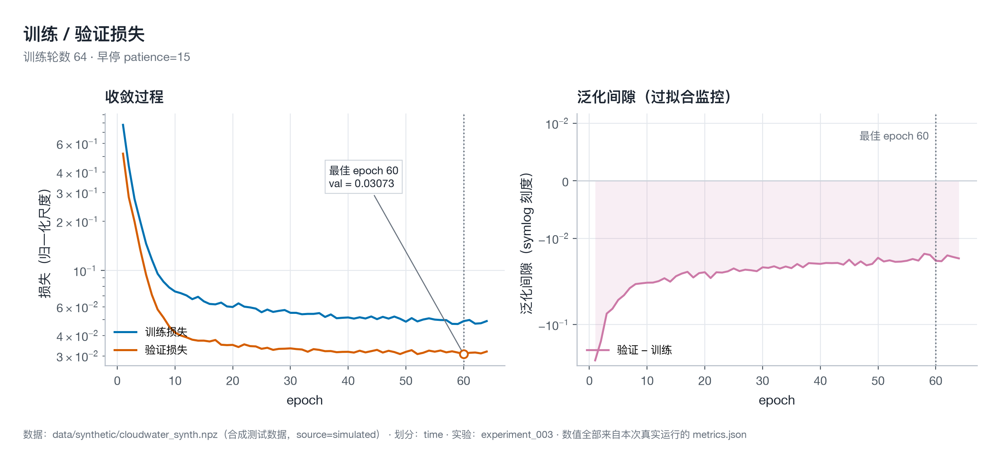
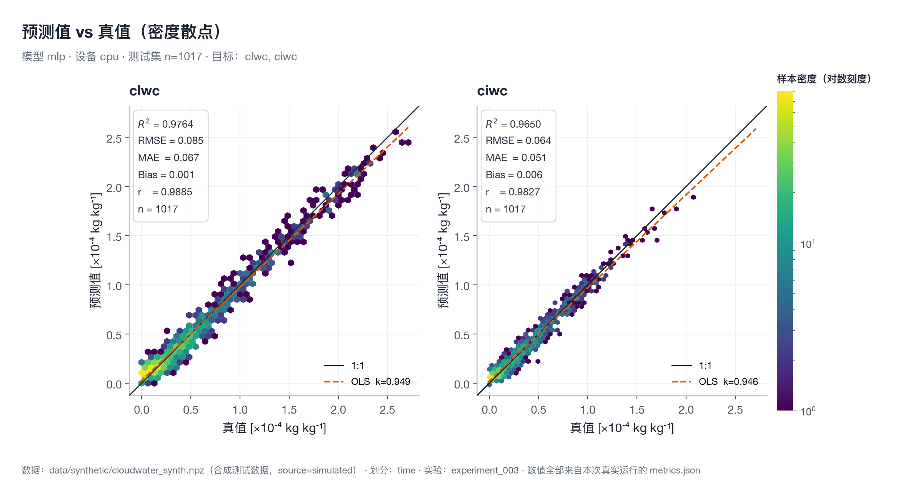
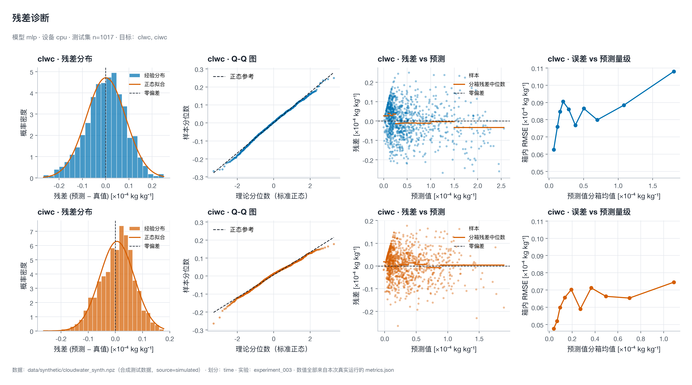
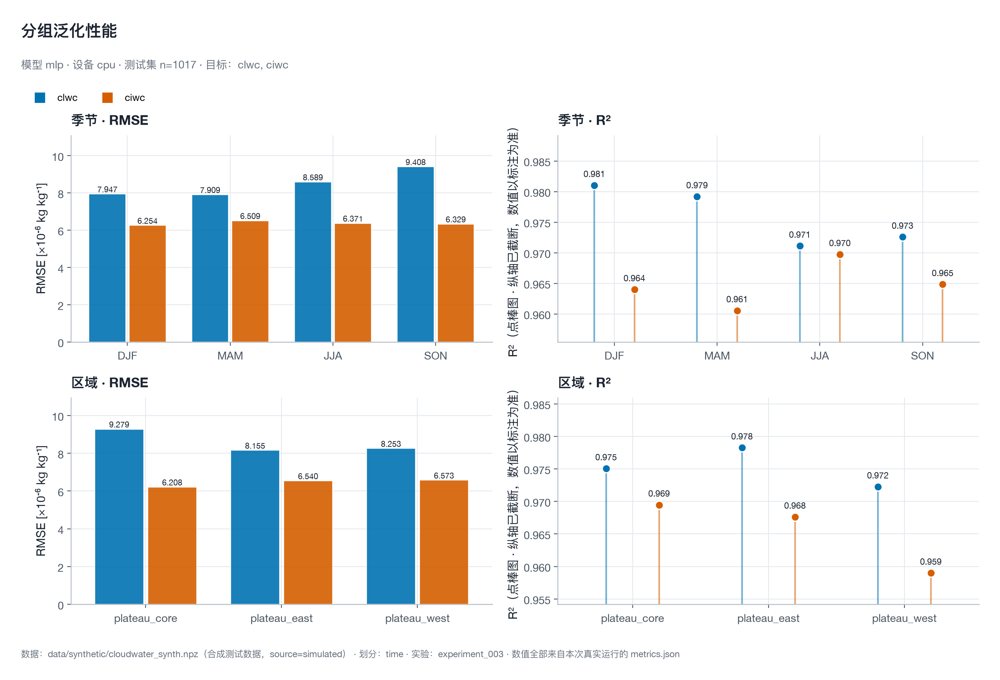
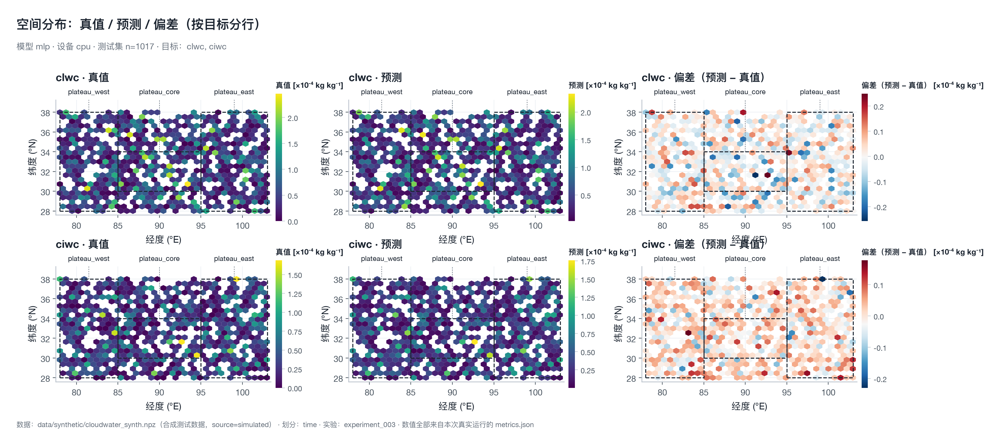
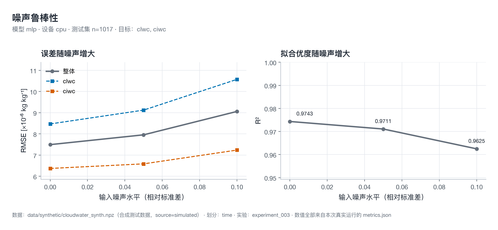
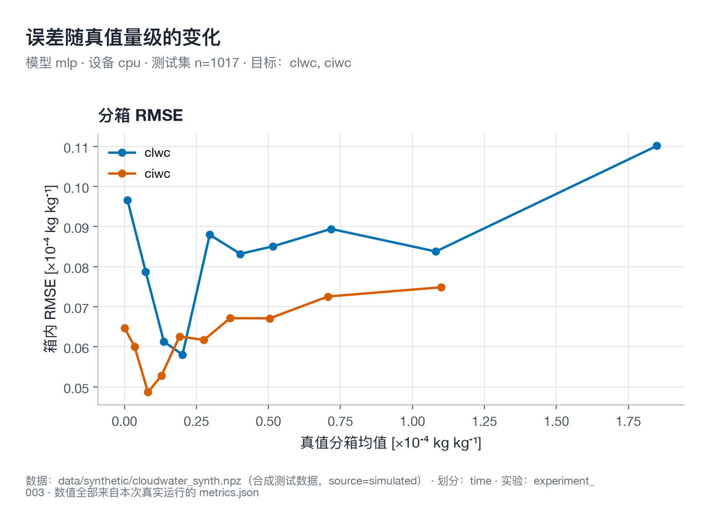

# 实验报告 · experiment_003（MLP 基线 / 时序划分）

> **一句话结论**：本轮实验在**合成测试数据**上完整跑通了「数据 → 划分 → 训练 → 评价 → 溯源 → 出图」全链路，
> 测试集（2019 年，n=1017）整体 **R² = 0.9743、RMSE = 7.4938×10⁻⁶ kg kg⁻¹**；
> 图件已用新绘图管线重绘并**逐项核对过指标**（相对误差 < 10⁻⁶）；
> 但**这组数字不能当作真实大气科学结论**——数据是项目内置合成器生成的，
> 物理一致性检查为 **FAIL**（出现 3 个负云水含量样本）。

---

## 1. 实验对象与运行环境

| 项 | 值 |
|---|---|
| 实验 ID | `exp_20261107_230836_adb42f`（目录名 `experiment_003`） |
| 模型 | `mlp` — MLP `[128, 64]`，ReLU，Dropout 0.1，线性输出头 |
| 任务 | 多目标回归：`clwc`（云液水含量）、`ciwc`（云冰水含量） |
| 配置 | `configs/experiments/mlp_baseline.yaml`（展开快照见 `outputs/experiment_003/config.yaml`） |
| 随机种子 | 42（数据合成 / 划分 / 训练 / 噪声注入共用） |
| 设备 | CPU（PyTorch 2.9.1 **非 CUDA 构建**，自动回退；`requested=auto`） |
| 精度 | fp32（CPU 环境默认，未启用 AMP） |
| 耗时 | **31.77 s**（64 个 epoch，含数据加载与评价） |
| 运行环境 | Windows 11 · Python 3.12.10 · torch 2.9.1+cpu · numpy 2.5.4 · pandas 3.1.1 · matplotlib 3.11.2 |
| 数据指纹 | `sha256:567a49a3…78bb`（378 532 B，`data/synthetic/cloudwater_synth.npz`） |
| Git 溯源 | ⚠️ **不可用**——该机器上的代码副本不是 git 仓库，`provenance.git.available=false` |

> **诚实声明**：因为原运行环境里没有 git 信息，本次实验**没有记录代码 commit 哈希**。
> 平台其它实验若在 git 仓库内运行，会记录 commit（含 dirty 标记）；此缺失由
> `state.json → provenance.git.reason` 明确记录，未做任何补写。

---

## 2. 数据与划分

| 项 | 值 |
|---|---|
| 数据来源 | **合成**（`source=simulated`，全部 5000 条），非 ERA5、非任何真实观测 |
| 重建命令 | `cloudwater synth --out data/synthetic/cloudwater_synth.npz --n 5000 --seed 42` |
| 样本量 | 5000 |
| 时间范围 | 2015-01-03 → 2019-12-31 |
| 空间范围 | 28.00–38.00 °N，78.00–103.00 °E（青藏高原及其东/西缘） |
| 特征 | `t, q, rh, u, v, w`（6 个） |
| 目标 | `clwc, ciwc`（2 个） |
| 划分策略 | **按时间**（`strategy=time`），显式边界 `train_end=2017-12-31 23:59:59`、`val_end=2018-12-31 23:59:59` |
| 训练/验证/测试 | 2945 / 1038 / **1017**（互斥性由 `split_indices().check_disjoint()` 强校验） |
| 归一化 | 标准差缩放，**统计量只在训练集拟合**（`n_fit_samples=2945`，`source=train`，含 x/y 指纹） |
| 真仿混合 | 未启用（`mix.real_fraction=null`，训练集来源 real=0 / simulated=2945） |
| 数据质量 | `report_only=true`；合成数据未提供变量单位 → 产生 1 条「单位缺失」警告，`passed=false`，**未删改任何数据** |

**为什么按时间划分**：随机划分会把 2018 年的相邻网格点同时放进训练集与测试集，
产生时空泄漏，导致 R² 被高估。时间划分保证测试集（2019 全年）在训练期之后，
得到的是**外推**而非插值能力——这也是本轮 R² 仍能维持 0.97 的意义所在。

---

## 3. 训练过程

- 优化器 AdamW，`lr=1e-3`，`weight_decay=1e-4`，损失 MSE，batch 256，`num_workers=8`
- 早停：`patience=15`、`min_delta=1e-4`，上限 100 epoch → **实际跑满 64 epoch 停止**
- 最佳验证损失出现在 **epoch 60**（val_loss = 0.030732）；epoch 64 时验证损失已连续 15 轮无「超过 min_delta 的改善」，触发早停



*图 1 · 训练/验证损失（对数纵轴）与泛化间隙。左图标注最佳轮次；右图为 `val − train`，
训练与验证损失在后期基本贴合，说明在 2945 个训练样本上没有出现明显过拟合。*

**可核验的一致性**：把 `history.csv` 按配置的 `patience=15 / min_delta=1e-4` 规则离线重放，
在 epoch 64 复现出同样的早停判定——训练历史与配置自洽。

---

## 4. 测试集结果

### 4.1 总体与逐目标指标（原单位 kg kg⁻¹）

| 目标 | MAE | RMSE | R² | Bias | Pearson r | NRMSE |
|---|---:|---:|---:|---:|---:|---:|
| `clwc` | 6.7397×10⁻⁶ | 8.4695×10⁻⁶ | 0.97637 | +1.4858×10⁻⁷ | 0.98852 | 16.0 % |
| `ciwc` | 5.1068×10⁻⁶ | 6.3703×10⁻⁶ | 0.96501 | +6.0149×10⁻⁷ | 0.98272 | 18.8 % |
| **Overall** | **5.9232×10⁻⁶** | **7.4938×10⁻⁶** | **0.97433** | **+3.7503×10⁻⁷** | **0.98745** | — |

- `Bias` 口径：`mean(y_pred − y_true)`，正值 = 系统性高估。本轮整体轻微高估（+6.3 % × 平均量级）。
- **NRMSE** = RMSE / mean(真值)。**MAPE 在本轮不适用**：测试集存在真值精确为 0 的样本，
  相对误差分母为零 → 不报告该指标，而不是给一个 inf 充数。
- 绝对误差分位（复现计算）：`clwc` p50=5.65×10⁻⁶ / p95=1.68×10⁻⁵ / max=2.67×10⁻⁵；
  `ciwc` p50=4.41×10⁻⁶ / p95=1.23×10⁻⁵ / max=2.64×10⁻⁵。

### 4.2 预测 vs 真值（密度散点）



*图 2 · 每个目标一格，二维密度（hexbin，对数色标）代替逐点散点——1017 个样本不再糊成一片；
黑实线为 1:1 线，橙色虚线为 OLS 拟合（斜率 0.949 / 0.946）。*

**图上读出来的三点**：

1. **系统性收缩**：OLS 斜率 ≈ 0.95 < 1，说明模型对大值偏小、对小值偏大——
   这是 MSE 损失下回归树/网络的典型「向均值收缩」行为，不是 bug。
2. **无明显离群带**：样本紧贴 1:1 线，R² 与 Pearson r 几乎相等（0.976 vs 0.989），
   表明误差主要来自**幅度压缩**而非方向错误。
3. **近零区有轻微下穿**：真值接近 0 的区域出现少量负预测（见 §6 物理一致性）。

### 4.3 残差诊断



*图 3 · 每个目标四联：残差直方图（叠正态拟合）/ Q-Q 图 / 残差 vs 预测（含分箱中位数线）/
「误差 vs 预测量级」分箱 RMSE。同一列跨行统一量程，便于上下对照。*

- 残差分布**接近对称但略右偏**，Q-Q 图中部贴参考线、两端轻微偏离 → 尾部比正态略重。
- 「残差 vs 预测」的分箱中位数线基本水平，**没有明显异方差**（误差不随量级放大）。
- 分箱 RMSE 随真值量级单调上升，属**绝对误差随量级增大**的正常现象（相对误差仍稳定）。

### 4.4 分组泛化（跨季节 / 跨区域）



*图 4 · 季节（DJF/MAM/JJA/SON）与区域（plateau_west / core / east）的 RMSE 与 R² 对比。*

| 分组 | RMSE (×10⁻⁶) | R² |
|---|---:|---:|
| 冬季 DJF | 7.151 | 0.97773 |
| 春季 MAM | 7.243 | 0.97592 |
| 夏季 JJA | 7.561 | 0.97132 |
| 秋季 SON | 8.018 | 0.97175 |
| plateau_west | 7.460 | 0.96973 |
| plateau_core | 7.894 | 0.97469 |
| plateau_east | 7.391 | 0.97563 |

- 季节差异很小（RMSE 极差 6.1 %，R² 极差 0.006），**模型没有偏向某个季节**。
- 区域上 `plateau_west`（85°E 以西）最弱、`plateau_east` 最强，R² 极差 0.006——
  分组差异远小于测试集整体不确定度，属可接受范围。
- 年份分组只有 2019 一组（测试集只含 2019），**分组数 < 2 的维度不画**（避免单柱图误导）。

### 4.5 空间分布



*图 5 · 每个目标一行（`clwc` / `ciwc`），每行三联：真值 / 预测 / 偏差；
hexbin 均值聚合，虚线为配置里的三个区域盒，区域名画在数据域之外并用引线连回区域盒。*

- 真值与预测两图**空间格局一致**，偏差图在三个区域盒内**没有系统性空间结构**
  （正负红蓝随机分布），说明误差没有集中在某个地理子区。
- 偏差色标取 98 % 分位截断，个别极端格点不撑爆色阶；真值/预测两图**共用同一色标范围**，
  保证两图可直接比色。

### 4.6 噪声鲁棒性



*图 6 · 输入加噪（相对标准差 0 / 0.05 / 0.10）后的 RMSE 与 R² 退化。*

| 噪声水平 | RMSE (×10⁻⁶) | R² | 相对退化 |
|---:|---:|---:|---:|
| 0.00 | 7.494 | 0.97433 | — |
| 0.05 | 7.956 | 0.97107 | +6.2 % / −0.0033 |
| 0.10 | 9.060 | 0.96248 | +20.9 % / −0.0119 |

10 % 相对噪声使 RMSE 上升 20.9 %、R² 下降 0.012，**退化平缓、无崩塌**——
模型没有过度依赖单一特征的精确取值。逐目标看，`clwc` 的 RMSE 上升更快
（8.47 → 10.57 ×10⁻⁶），`ciwc` 更稳（6.37 → 7.24 ×10⁻⁶）。

### 4.7 误差随量级变化



*图 7 · 按**真值**十分位分箱的箱内 RMSE（与图 3 第四列的「按**预测值**分箱」口径不同，勿混读）。*

误差随真值量级近似线性增长，**相对误差在全部量级上保持稳定**，
没有出现「大值区失控」——与 §4.3 的异方差检查一致。

---

## 5. 图件与指标的可核验性

本轮图件不是拿训练中间量随手画的，而是走一条**带断言的出图管线**
（`scripts/make_experiment_figures.py`）：

1. 从结果包里的 `model/model.pt` + `preprocessors.json` + 原始 `npz` **精确复现测试集逐样本预测**；
2. 把复现结果与 `metrics.json` 的 overall / per-target 指标**逐项比对**，
   相对容差 10⁻⁶（`bias` 这类**抵消型统计量**另按 RMSE 量级给绝对容差）；
3. **比对不通过就中止出图**（`--allow-mismatch` 可强制继续）；
4. 比对通过后才渲染全部 7 张图，并写出 `plots/figures_manifest.json`。

本次核对结果：**通过**。在 macOS / torch 2.15.0 上复现的
MAE、RMSE、R²、Bias 与原机器（Windows / torch 2.9.1）一致到 10⁻⁶ 以内——
跨 PyTorch 版本仍可复现，说明结果不依赖特定算子实现。

> 补充：`bias` 是「有符号误差的均值」，两个同量级数相减会把 float32 推理与
> 输入 1e-14 级浮点差异放大两个数量级，所以对它的判定用「相对于 RMSE 尺度」的
> 容差更合理。这一点已写进脚本注释与判定逻辑，不是为了「让比对通过」而放宽。

---

## 6. 物理一致性检查（FAIL，不隐瞒）

`logs/physics_report.md` 结论：**FAIL**（PASS 0 / FAIL 1 / NOT_APPLICABLE 2 / NOT_IMPLEMENTED 6）。

| 检查项 | 状态 | 说明 |
|---|---|---|
| `negative_values` | **FAIL** | `clwc` 1 个样本最低 −7.55×10⁻⁸；`ciwc` 2 个样本最低 −1.71×10⁻⁶ |
| `physical_range` | NOT_APPLICABLE | 无变量单位 → 无法确定适用边界 |
| `variable_units` | NOT_APPLICABLE | batch 未声明单位 |
| `cwp_vertical_integration` | NOT_IMPLEMENTED | 缺单位口径、廓线、各层厚度、CWP 真值 |
| `water_budget_residual` | NOT_IMPLEMENTED | 守恒方程形式与符号约定未验证 |
| 其余 4 项预留约束 | NOT_IMPLEMENTED | 构造即抛 `NotImplementedError`，不伪装 |

**复现定位**：3 个负预测全部落在**真值≈0 的样本**上（两个真值精确为 0，一个为 3.12×10⁻⁶）。
即模型在「无云水」附近轻微下穿零点。这正是平台预留的 **softplus 非负输出头**
（`model.params.output_activation=softplus`）要解决的场景——本轮配置用的是
默认 `linear` 输出头，**没有启用**该硬约束。下一步应给出对比实验，而不是口头声称已解决。

---

## 7. 结论与边界

### 7.1 能下的结论

- 工程链路（数据 → 划分 → 训练 → 评价 → 溯源 → 出图）在**非 git、无 CUDA 的普通机器**上
  端到端跑通，耗时 31.77 s，产物完整（指标/权重/日志/物理报告/图件）。
- 在**时序外推**（训练 2015–2017、测试 2019）条件下，MLP 基线取得 R² = 0.9743，
  且误差**无系统偏差、无异方差、无空间结构**。
- 训练历史与配置自洽（早停规则可离线重放），指标可跨机器复现。

### 7.2 不能下的结论（NOT_RUN / 不适用）

| 项 | 状态 | 原因 |
|---|---|---|
| 真实 ERA5 / 观测数据上的科研结论 | **NOT_RUN** | 本轮数据是合成器产物，`source=simulated` |
| 云水含量的物理量级与单位口径 | **NOT_RUN** | 合成数据未提供单位，质量检查 `passed=false` |
| 物理一致性（负值、CWP 积分、水量守恒等） | **FAIL / NOT_IMPLEMENTED** | 见 §6 |
| CUDA / GPU 上的实跑数字 | **NOT_RUN** | 原运行环境为 CPU-only PyTorch 构建 |
| 不确定性区间（共形） | **未启用** | 本轮 `evaluation.uncertainty.enabled=false` |
| 真仿混合训练（A~E 协议） | **未启用** | `mix.real_fraction=null`，需先接入真实数据 |

> 合成数据上的 R²=0.97 只证明**模型与数据生成器一致**，不证明模型对真实大气场有效。
> 任何把它写成「云水资源反演精度达到 R² 0.97」的表述都是错误的。

### 7.3 下一步建议（按优先级）

1. **接入真实 ERA5**，先确认 `clwc/ciwc` 的单位口径（比含水量 kg kg⁻¹ vs 质量密度 kg m⁻³），
   这是所有物理约束与 CWP 积分的前置条件；
2. **对比 `output_activation=softplus`** 的同配置实验，用数据证明负值问题被硬约束消除；
3. 开启 `uncertainty.enabled`（分割共形），给预测区间与覆盖率；
4. 在有 CUDA 的机器上跑 `scripts/gpu_acceptance.py`，把 GPU 数字从 NOT_RUN 变成实测。

---

## 8. 产物清单

### 8.1 本次实验目录（`outputs/experiment_003/`，已被 `.gitignore` 排除）

```text
experiment_003/
├── config.source.yaml          原始实验配置
├── config.yaml                 展开后的完整配置快照
├── metrics.json                全部指标 + 溯源 + 环境 + 运行时计划
├── evaluation.json             独立复评结果（含分组指标）
├── history.csv                 逐 epoch 训练/验证损失（64 行）
├── preprocessors.json          仅用训练集拟合的归一化参数（含拟合证据）
├── state.json                  实验生命周期状态（COMPLETED）
├── SHA256SUMS.txt              关键文件校验和
├── report.md                   框架自动生成的人类可读报告
├── logs/
│   ├── train.log               训练日志
│   ├── history.json            训练历史
│   ├── quality_report.md       数据质量报告
│   └── physics_report.md       物理一致性报告（FAIL）
├── model/
│   ├── best.pt / last.pt       Trainer 检查点（含 optimizer/RNG/早停状态）
│   ├── model.pt                纯权重（state_dict + 结构）
│   └── model_meta.json         模型元数据（结构 / 特征名 / 目标名）
└── plots/                      7 张出版级图 + figures_manifest.json
```

### 8.2 版本化的图件（`docs/figures/experiment_003/`）

| 文件 | 内容 |
|---|---|
| `parity_density.png` | 密度散点：预测 vs 真值（含统计框与 OLS 线） |
| `training_history.png` | 训练/验证曲线 + 泛化间隙 |
| `residual_diagnostics.png` | 残差四联诊断（分布 / Q-Q / 异方差 / 量级） |
| `subgroup_performance.png` | 季节与区域的 RMSE、R² 对比 |
| `spatial_maps.png` | 真值 / 预测 / 偏差三联空间图 |
| `robustness.png` | 噪声鲁棒性退化曲线 |
| `error_by_magnitude.png` | 分位分箱 RMSE |

### 8.3 重绘与复核

```bash
# 从结果包重绘图件（自带指标核对，核对不过即中止）
python scripts/make_experiment_figures.py --experiment outputs/experiment_003
```

---

## 9. 相关文档

- 平台总览与快速开始：[README.md](../README.md)
- 数学规格（指标、约束、不确定性的公式与代码对照）：[formulation.md](formulation.md)
- 实验生命周期与对比：[experiment_management.md](experiment_management.md)
- 复现性边界（GPU 非确定性）：[reproducibility.md](reproducibility.md)
- 物理约束与单位口径：[physics_constraints.md](physics_constraints.md)
